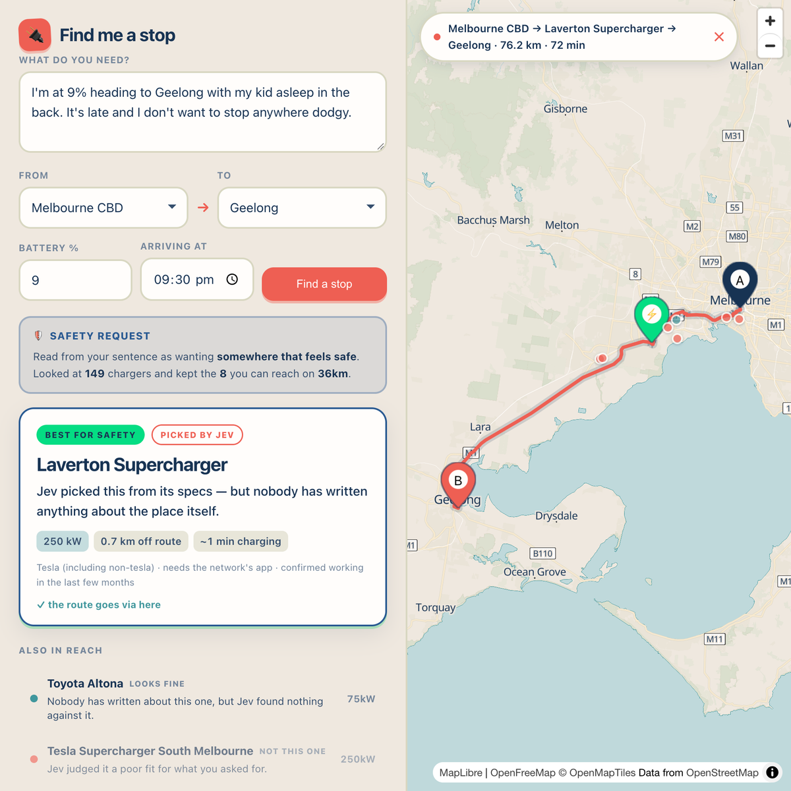

# Find me a stop - an EV charging-stop planner built with Jev

Describe your situation in one sentence, choose where you're driving from and to, set your battery level and arrival time, and the app finds the charger on your route that best fits what you asked for.

> _"I'm at 9% heading to Geelong with my kid asleep in the back. It's late and I don't want to stop anywhere dodgy."_

The decision is made by [Jev](https://openrouter.ai/docs/guides/community/typesafe-sdk), TypeSafe AI's "System One" model. It doesn't generate text - it answers structured questions with typed answers and probabilities, in a single request.

<!-- Uncomment once the article is live and its URL is confirmed:
I built this for my article **[Is Jev Just Hype, or a Genuinely Different Kind of AI?](https://www.trpkovski.com/2026/09/28/is-jev-just-hype-or-a-genuinely-different-kind-of-ai)**, which walks through the project in detail.
-->



## How It Works

**Code filters, Jev picks.** Code does all the arithmetic and only ever rules chargers out. The winner always comes from Jev.

1. **Find candidates.** Code fetches chargers from [Open Charge Map](https://openchargemap.org) in a box around your journey.
2. **Shortlist.** Code drops anything not operational or out of reach, sorts the rest by total added time (detour driving plus charging) and keeps the best 8. Range assumes a 500km car, derated by 0.8 for real-world driving, with a 15% reserve so you never arrive on zero.
3. **Turn numbers into words.** Jev can't do arithmetic, so code describes every figure in plain English first - `250 kW` becomes "very fast charging", `0.7 km` becomes "barely off your route".
4. **Ask Jev.** One request with 28 questions: what the driver cares about most, whether they're travelling with others, how well each charger suits them, whether its notes limit when it can be used, what its cost notes amount to, and finally which charger suits them best.
5. **Apply the gates.** A charger is ruled out if its "suits" score is below 1.6, or if its notes describe limited hours and you'd arrive after dark. Of the chargers left, the winner is the one Jev's final answer gave the highest probability. If none are left, the app says so instead of guessing.

A search costs about $0.0002 and Jev usually answers in around 300ms.

## Prerequisites

- Node.js 20 or later
- An [OpenRouter](https://openrouter.ai) API key, for Jev
- Optionally, a free [Open Charge Map](https://openchargemap.org) API key (My Profile → My Apps → Register An Application)

## Getting Started

```bash
npm install
cp .env.example .env    # then add your keys
npm run dev
```

Open [http://localhost:3100](http://localhost:3100).

## Environment Variables

| Variable             | Required | What it does                                                                                                                                                                                                  |
| -------------------- | -------- | ------------------------------------------------------------------------------------------------------------------------------------------------------------------------------------------------------------- |
| `OPENROUTER_API_KEY` | Yes      | Calls Jev through OpenRouter.                                                                                                                                                                                 |
| `OCM_API_KEY`        | No       | Fetches live charger data. Without it, the app falls back to `fixtures/au-chargers.json` - 231 real records recorded in September 2026, mostly in Victoria - so Melbourne trips work but other cities have few options. |
| `JEV_MODEL`          | No       | Defaults to `typesafe/jev-1.13`. The model is pinned on purpose: every threshold in the app is tuned to it.                                                                                                   |
| `JEV_BASE_URL`       | No       | Defaults to `https://openrouter.ai/api`. Leave `/v1` off - the SDK adds `/v1/systemone` itself.                                                                                                               |

## Scripts

| Command              | What it does                         |
| -------------------- | ------------------------------------ |
| `npm run dev`        | Start the dev server on port 3100    |
| `npm run build`      | Production build                     |
| `npm start`          | Serve the production build on 3100   |
| `npm test`           | Run the test suite once              |
| `npm run test:watch` | Run the tests in watch mode          |
| `npm run typecheck`  | Type-check without emitting anything |

## Supported Places

Start and end points: Melbourne CBD, Geelong, Ballarat, Bendigo, Traralgon, Sydney CBD, Wollongong, Newcastle, Canberra, Brisbane CBD, Gold Coast, Adelaide CBD, Perth CBD and Hobart.

## Project Structure

```
app/
  page.tsx              the whole UI: form, results and the MapLibre map
  api/plan/route.ts     shortlist, one Jev request, the gates, the final plan
  api/route/route.ts    the road route, used only to draw the line on the map
src/lib/
  ocm/                  Open Charge Map client and charger parsing, with the recorded fallback
  geo/                  distances, reach and the supported places
  jev/                  the Jev client and the questions it's asked
  plan/                 shortlisting, gating and building the plan
  verification/         how recently a charger was confirmed working
  route/                OSRM client
  map/                  the basemap theme
src/experiments/        one-off probe scripts I used while building the app
fixtures/               recorded Open Charge Map data
assets/                 the screenshot in this README
```

## Things Worth Knowing

- **Jev's choices can vary between runs.** In my testing, the winner for each of five Melbourne-to-Geelong test scenarios was the same every time, but the chargers that pass alongside it can shift.
- **Distances on the cards are straight-line.** The route drawn on the map follows real roads, so the two won't match exactly.
- **Routing uses the public OSRM demo server.** That's fine for trying the app, but not for heavy traffic.
- **Charger data is often stale.** Many Open Charge Map records haven't been confirmed working in years. The app shows this on every charger rather than hiding it.

## Data and Credits

- Charger data © [Open Charge Map](https://openchargemap.org) contributors, licensed [CC BY 4.0](https://creativecommons.org/licenses/by/4.0/)
- Map © [OpenFreeMap](https://openfreemap.org), © [OpenMapTiles](https://openmaptiles.org), data © [OpenStreetMap](https://www.openstreetmap.org/copyright) contributors
- Routing by [OSRM](https://project-osrm.org)
- Jev by TypeSafe AI, called through [OpenRouter](https://openrouter.ai)
